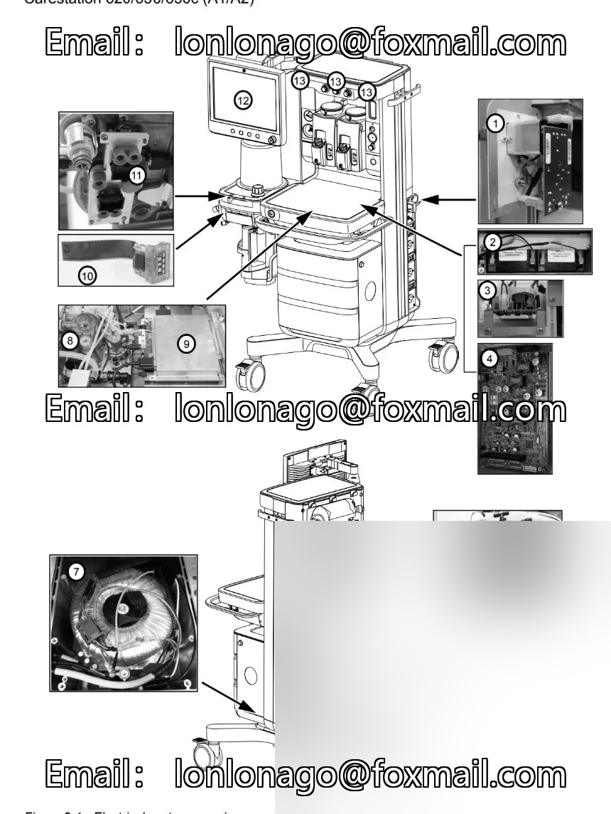
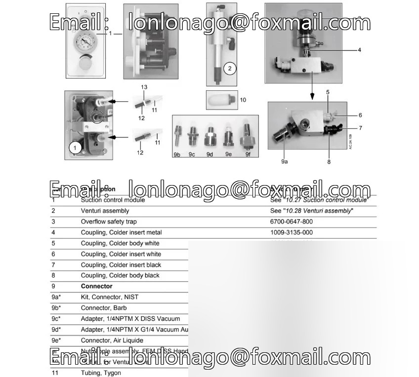
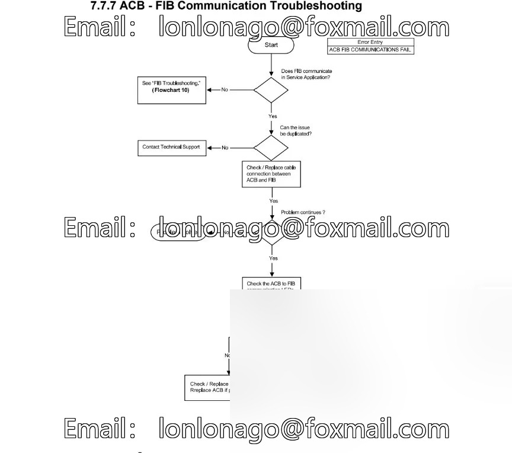
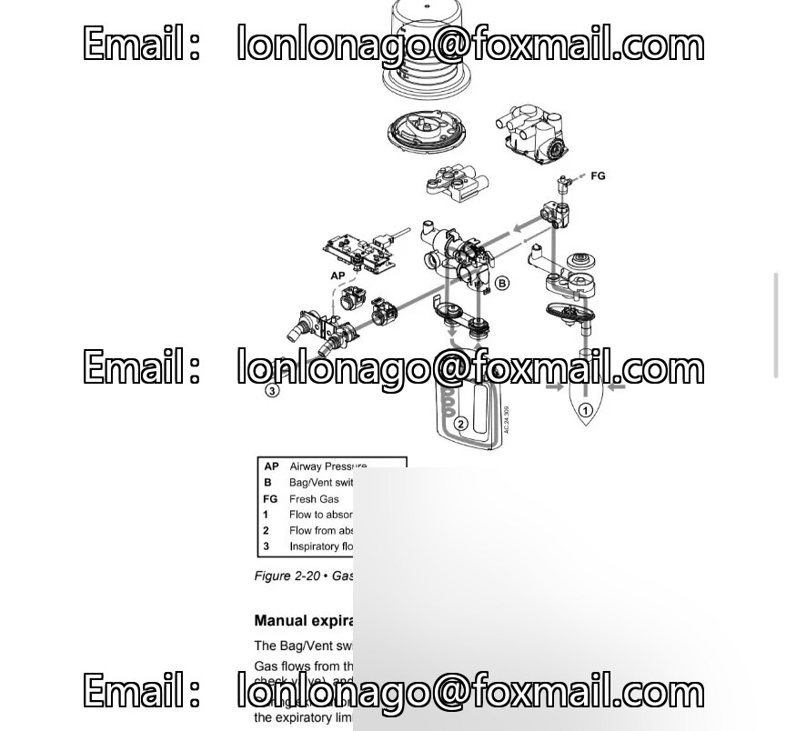
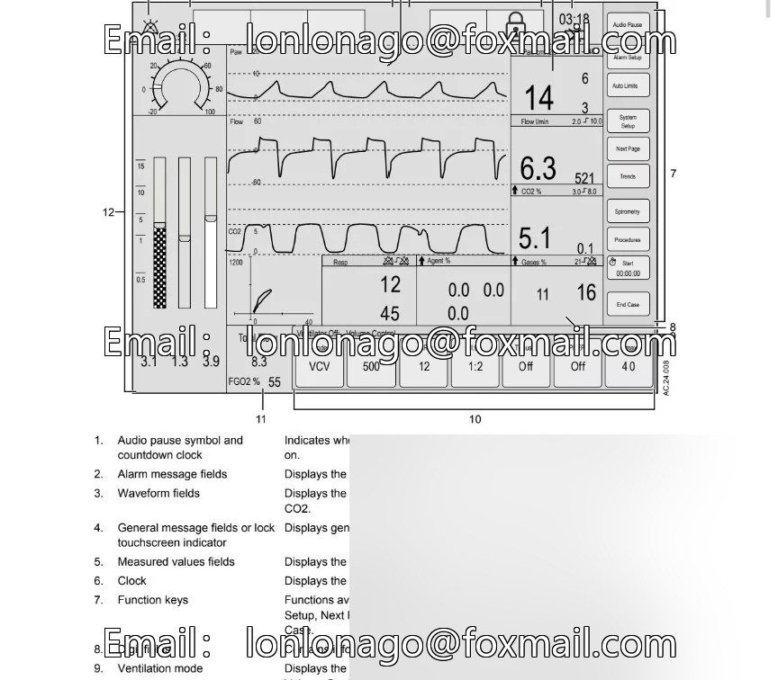
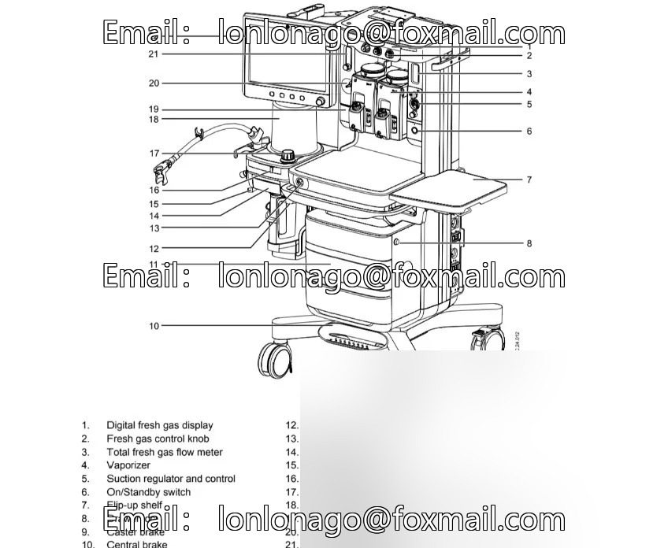

# Carestation 620/650/650c (A1/A2)

## Body

Carestation 620/650/650c (A1/A2) Anesthetic machine technical reference manual
480-page PDF version
The content covers device structure, functions, fault troubleshooting, maintenance, etc., and is suitable for maintenance and technical reference.
Requests direct on-site filming; contact for questions.
648249032

The manual covers equipment structure, function, troubleshooting and maintenance and is suitable for repair and technical reference, spanning 480 pages.

<!-- AI_ENRICHED -->

## Images

## Payment

Here is a pay link on Stripe ( https://buy.stripe.com/3cs8yP7sY87d0vu9AB ). Please contact me lonlonago@foxmail.com after funding $89, and I will send you a complete data files , thank you!

